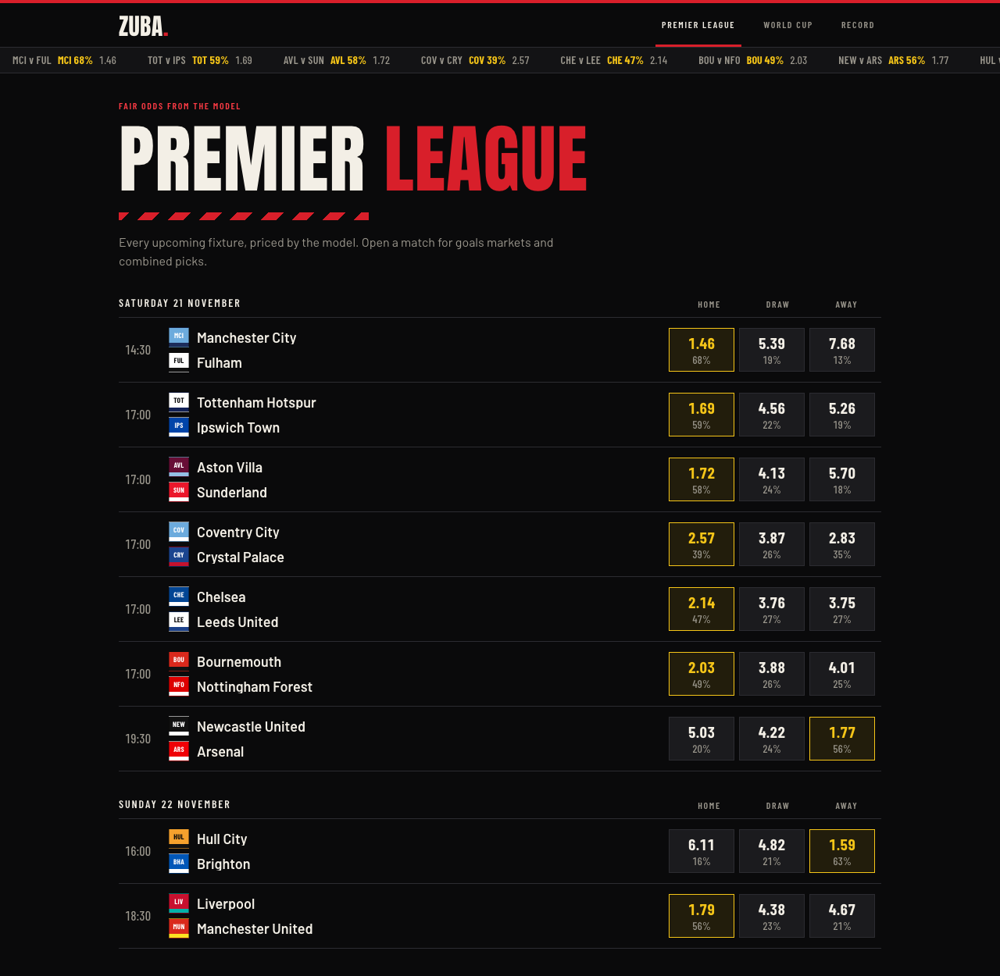
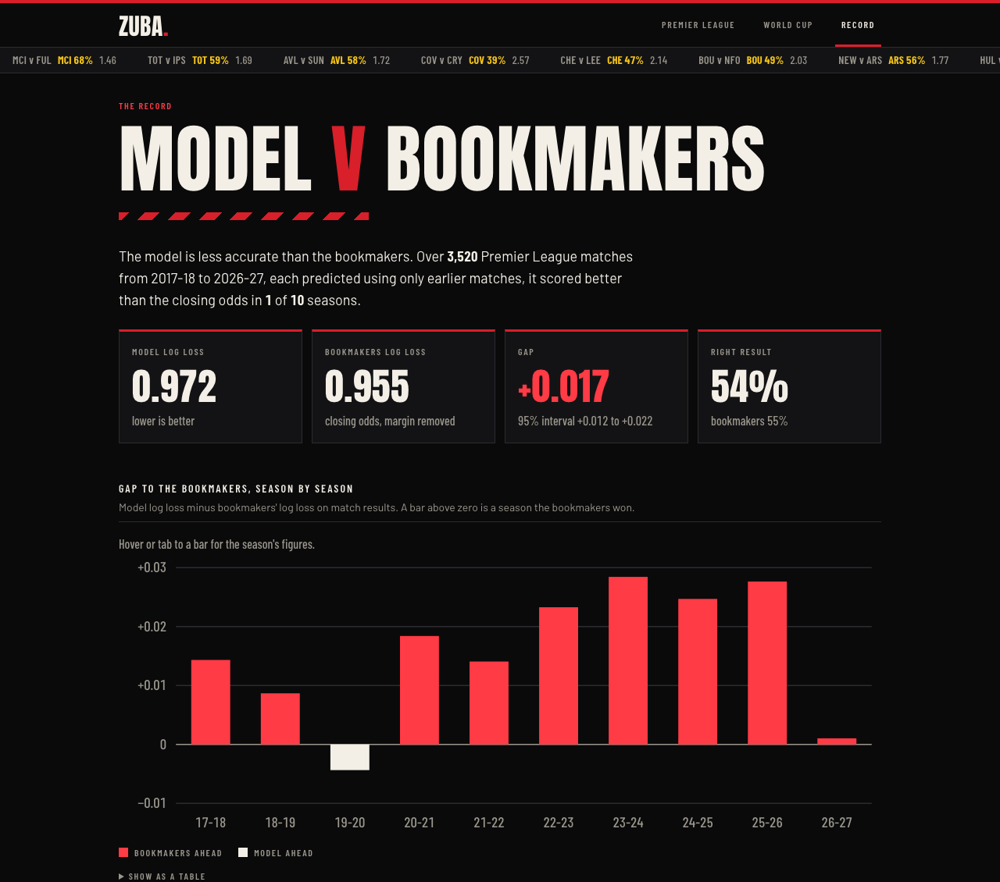

# zuba: football match predictions, tested against the bookmakers

Zuba predicts Premier League matches and shows the predictions as fair odds: the price each outcome would have if the model's probability were exactly right. It blends several statistical and machine-learning models, refits them every day through the season, and publishes its own record, including how far behind the bookmakers it is.

It started as a World Cup 2026 predictor. That model ran live through the tournament and is kept here, with its results, as a second competition.



## Premier League backtest

The Premier League models were tested on 3,520 matches from 2017-18 to 2026-27. Every match was predicted from earlier matches only, with the team models refitted each week, and scored against bookmakers' closing odds with the margin removed.

**Match result**

| Model | Log loss (95% interval) | Gap to bookmakers |
|---|---|---|
| Bookmakers' closing odds | **0.955** (0.938 to 0.971) | |
| Weighted blend | 0.972 (0.956 to 0.987) | +0.017 (+0.012 to +0.022) |
| Dixon-Coles | 0.973 | +0.019 |
| Plain average | 0.974 | +0.019 |
| XGBoost on form and shots | 0.977 | +0.022 |
| CatBoost on pi-ratings | 0.980 | +0.025 |
| LightGBM on Elo and form | 0.981 | +0.026 |
| Baseline: long-run frequencies | 1.067 | |

The blend beats each of its models and the plain average, and its probabilities are well calibrated (calibration error 0.005). It does not beat the bookmakers: the gap is 0.017 and its interval is entirely above zero. The blend scored better than the closing odds in one season of ten (2019-20).

For over/under 2.5 goals the blend scores 0.679, against 0.675 for the bookmakers and 0.690 for the baseline.

The blend weights are fitted on predictions from earlier seasons only. For live fixtures the result is 67% Dixon-Coles and 33% XGBoost; goals are 43% Dixon-Coles, 38% Poisson XGBoost and 19% GAP ratings on shots on target. CatBoost, LightGBM, and GAP on shots and on corners get no weight.

Run it with `uv run zuba backtest` (about 90 minutes). Full results are in `docs/backtest_epl.json`, and the site's Record page shows them with a calibration chart and this season's predictions against results.



## World Cup backtest

Each World Cup below was predicted using only matches played before that tournament's opening game. Only group-stage games are scored, because recorded knockout scores include extra time.

**Match result (168 group-stage games)**

| Model | Log loss | Brier | Right result |
|---|---|---|---|
| Ensemble (average) | 0.960 | 0.567 | 58% |
| Dixon-Coles | **0.929** | **0.547** | 60% |
| CatBoost on pi-ratings | 0.975 | 0.580 | 58% |
| LightGBM on Elo and form | 0.979 | 0.579 | 57% |
| Zeileis/Groll ensemble | 0.995 | 0.582 | 55% |
| Baseline: 1/3 on each result | 1.099 | 0.667 | 40% |

Lower is better for log loss and Brier score. The baseline's "right result" is the share of home wins, because it ties every game and falls back to the first option.

By tournament, the ensemble's log loss was 0.942 in 2018, 1.100 in 2022 and 0.877 in 2026. Qatar 2022 was no better than guessing: Saudi Arabia beat Argentina, Japan beat Germany and Spain, and Morocco topped its group. Every model missed those.

The ensemble doesn't beat its best member. Dixon-Coles alone scores better in all three tournaments. With only 168 games there is too little to fit blend weights on without overfitting them, so the World Cup ensemble stays a plain average.

Over/under 2.5 goals is barely better than a coin flip (log loss 0.690 against 0.693 for 50/50). The dataset has no shots or expected-goals data for national teams, and goals alone are too noisy to predict totals.

These numbers are from version 2.0. Version 1.0 scored 0.973 for the ensemble and 0.955 for Dixon-Coles on the same games. The gain came from four fixes: neutral venues are now flagged in every model (before, the first-listed team was priced as if at home), the boosted models stop adding trees when a held-out slice stops improving, the Zeileis/Groll calibration is learned on matches its classifiers hadn't seen, and the tournament-importance flag at prediction time matches the one used in training.

168 games is a small sample, so gaps of 0.01 in log loss between models are within noise.

Run it yourself with `uv run zuba backtest --competition wc` (about 2 minutes).

## How it works

### Premier League

```
data/clubs/   Premier League and Championship results, shots, shots on target
              and corners since 2008-09 (football-data.co.uk), xG where available
        │
        ├─ club Elo, pi-ratings, rolling form over each team's earlier matches
        │
        │  match result
        ├─ Dixon-Coles ............ scoreline grid, recent matches weighted more
        ├─ XGBoost ................ form, shots, shots on target, corners, xG, rest days
        ├─ CatBoost ............... pi-ratings
        ├─ LightGBM ............... Elo + form
        │
        │  goals
        ├─ Dixon-Coles ............ same grid
        ├─ Poisson XGBoost ........ expected goals for each side
        └─ GAP (Wheatcroft 2020) .. ratings on shots, shots on target and corners
                │
                ▼
        weighted blend → scoreline grid adjusted to match it → fair odds
```

The Championship is included so promoted teams arrive with ratings. Bookmaker odds are never a model input; they are used only in the backtest, as the yardstick.

The blend weights minimise log loss on predictions made for earlier seasons, so a model only gets weight if it adds something the others lack. After blending, the Dixon-Coles scoreline grid is rescaled until its result and over/under 2.5 probabilities equal the blended ones, so every market on a match page agrees with every other.

Each day a GitHub Actions run downloads new results and fixtures, refits the models, prices every unplayed match, simulates the rest of the season, and commits the results to `data/live/`. The hosted app serves that file and fits nothing itself. A prediction is never rewritten once its match has been played, so the season record on the site compares results with what the model said beforehand.

### World Cup

```
data/international_results.csv   (49,000 matches since 1872)
        │
        ├─ Elo ratings, rolled forward match by match (eloratings.net formula)
        ├─ pi-ratings (Constantinou & Fenton 2013)
        │
        ├─ Dixon-Coles ............ scoreline grid → result, goals, combinations
        ├─ CatBoost ............... pi-ratings → result
        ├─ LightGBM ............... Elo + last 3/5 games' form → result
        ├─ Zeileis/Groll .......... Elo, venue, tournament, confederation → result
        │                           (L1 logistic + random forest + XGBoost, isotonic-calibrated)
        └─ GAP (Wheatcroft 2020) .. attack/defence ratings → over/under
                │
                ▼
        plain average → fair odds
```

Every feature for a match comes from games played before it. Elo and pi-ratings are recorded before each result is applied, form skips the current game, and the backtest cuts the data off at each tournament's opening day.

### The predicted table

The Table page shows the league as it stands and where the model expects it to finish. Each pair of clubs meets home and away, so the matches left are the pairs with no result yet. Every one is priced by the blend, and the rest of the season is played out 20,000 times by drawing a scoreline for each match from its grid. The predicted table is the average of those seasons, with each club's chance of the title, the top four and relegation. `uv run zuba table` rebuilds it (about 35 seconds), and the daily refresh runs it after new results.

Each remaining match is priced from today's form, and a club's strength stays fixed within a simulated season, so the ranges shown are somewhat narrower than they should be.

### Combined picks and fair odds

Combined picks are read off the scoreline grid. "Spain to win and over 2.5 goals" is the sum of every scoreline where both happen. Multiplying the two separate probabilities would be wrong, because a team that wins tends to score more.

Fair odds are 1 / probability. The site shows no bookmaker prices.

## Bugs found along the way

penaltyblog's `totals(line)` returns `(under, push, over)`. An earlier version read it the other way round, so every over/under probability was inverted, and an early backtest that looked profitable was really measuring the opposite bet.

`update_ratings` in penaltyblog takes the goal difference as its third argument. The old code passed home goals there and put away goals in the date argument, so the pi-ratings learned from the wrong number. Fixing it changed CatBoost's predictions but not its overall score (log loss 0.989 before, 1.000 after, within noise).

## Running it

Needs Python 3.12+ with [uv](https://docs.astral.sh/uv/), and Node 20+ for the site.

```bash
uv sync
uv run zuba pick Arsenal Chelsea                    # one-off prediction (about 10 seconds)
uv run zuba pick Brazil Morocco --competition wc    # World Cup models (about a minute)
uv run pytest                                       # fast tests, no model training
```

To run the site:

```bash
uv run zuba fetch                        # new results, and fixtures from ESPN (3 days back to 25 ahead)
uv run zuba predict                      # price every unplayed fixture
cd frontend && npm ci && npm run build && cd ..
uv run uvicorn zuba.api.app:app --port 8001
```

Then open http://localhost:8001. If the local database is empty, the app starts from the committed snapshot in `data/live/site.json`, so the last two commands are enough to see the site. Set `ZUBA_REFRESH_AT=09:00` to refresh fixtures and predictions daily, and `ZUBA_LINEUPS=1` to pull starting XIs from ESPN about 50 minutes before kickoff.

Every command takes `--competition wc` for the World Cup models.

### Hosting

`Dockerfile` builds the site and API into one image that serves the committed snapshot; `docker build -t zuba . && docker run -p 8001:8001 zuba` runs it locally. `fly.toml` deploys that image to Fly.io. `.github/workflows/refresh.yml` runs the daily refresh and, if the repository has a `FLY_API_TOKEN` secret, redeploys afterwards. `.github/workflows/ci.yml` runs the linters, tests and frontend build on every push.

## Layout

```
src/zuba/
  data/              load results (clubs, international) and download new ones
  ratings/           Elo, pi-ratings, GAP, confederations
  features.py        the leak-free feature table for the boosted models
  models/            Dixon-Coles, boosted trees, Zeileis/Groll
  stacks/            one model stack per competition, and the blend weights
  markets.py         turn predictions into every market and save them
  evaluate/          walk-forward backtest, metrics with intervals, bookmaker benchmark
  espn.py            fixtures, scores and lineups
  table.py           the current table, and the season simulated to its end
  snapshot.py        save and load fixtures and predictions as JSON
  cli.py             the `zuba` command
  api/               FastAPI app, fair-odds board, combined picks, record
frontend/            React + Vite + Tailwind
data/clubs/          one CSV per league and season
data/live/           the snapshot the hosted site serves
tests/
```

## How I built it

I wrote this with Claude Code. I chose the models from the papers they come from, decided how to test them (one tournament at a time, nothing from after the opening game), checked the output against real results, and tracked down the bugs above. Claude wrote most of the code to my spec, and I reviewed it.

It started as a joint project with my brother, who built the original data scrapers and database. This repository is my rewrite of the modelling and the site, with his parts replaced by a public results dataset and ESPN's API.

## Data

- Club results, shots, corners and closing odds: [football-data.co.uk](https://www.football-data.co.uk/).
- Expected goals for August 2014 to January 2025: Understat.
- International results: [martj42/international_results](https://github.com/martj42/international_results) (CC0).
- Fixtures, scores and lineups: ESPN's public scoreboard API.
